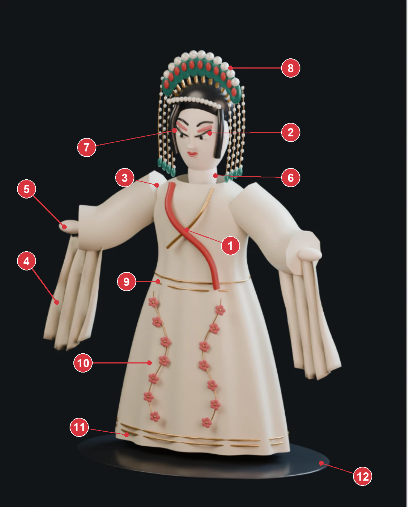

# 《戏城》旦角 3D 模型第二版细修说明

2026-11-06

第二版的目标：在游戏里约 250 像素高时，一眼看出是一位清秀的旦角，水袖能舞起来，导出后能直接接进网页游戏。

这份说明给 Codex，在 Blender 里做第二版。模型默认是玩家的台上扮相，站在桌上的小戏台上表演，引擎是 Three.js r128。

评审只看了一张正面偏 3/4 的渲染图。背面、线框、UV 和骨骼都没看到，下面只评能看见的部分。

## 第一版总评

配色和头面方向是对的，要保留；问题集中在大形：身体像一只钟，袖子像两截木块，脸是怒相，衣襟方向也反了。

保留这些：

- 奶白衣身配朱红和金的主色
- 珍珠、绿地、红点的头面造型和两侧珠串
- A 字长裙的整体方向
- 白底脸和小红唇
- 梅花的纹样主题

图上的编号对应下一节的清单。

## 细修清单

前 6 项先修，它们决定这是不是一位旦角；后 6 项在大形确认后再做。H 表示头高（发顶到下巴）。

### 必须先修

| # | 部位 | 现状 | 改法 | 验收 |
| --- | --- | --- | --- | --- |
| 1 | 衣襟 | 从图上看是左衽：穿着者的右襟压左襟。红衣领像一根圆管，金线压在布外。 | 改成右衽：穿着者的左襟压右襟。衣领改成贴身的平布带，宽约 0.2H，金边画在贴图上。 | 正面看是小写 y 形：上层领从观众右肩斜到观众左腰。没有圆管截面。 |
| 2 | 眉眼 | 眉头压向鼻梁，粉色硬线斜在眉上，视线偏向一侧，读起来在生气。 | 改细长柳叶眉：眉头平，眉尾微扬。胭脂从眼窝向脸颊晕开，取代粉色硬线。眼尾上挑，视线正前。 | 头部缩到约 50 像素高，表情是温婉或冷静，不是怒。 |
| 3 | 肩和袖 | 肩头有三角硬面，袖子几乎和头一样粗，袖口是硬折角。 | 溜肩，袖子与衣身连成一体，从肩到袖口渐渐放宽。平滑着色，清掉 N-gon。 | 看不到三角面和硬折角，肩到袖口是一条顺线。 |
| 4 | 水袖 | 几条并排的硬条挂在手下，像木板，末端平切，和袖口不相连。 | 从袖口整圈接出一整幅薄绸，垂下 3–4 道自然褶，末端有波浪。单层薄片，双面显示，带 5 节骨骼。 | 侧面看是薄片。挥起来没有硬折线，不穿进身体。 |
| 5 | 手 | 手是一个胶囊，压在水袖上。 | 手从袖口伸出，指尖半藏在水袖里。做手套式分组就够：拇指加并拢的四指。 | 看不出胶囊形，水袖是从袖口出来的，不是从手上挂下来的。 |
| 6 | 头颈 | 颈是粗短圆柱，领口有一圈缝，下巴和脖子分不开。 | 颈收细，加一道白色护领盖住领口。脸改成鹅蛋形，下巴收尖。 | 任何角度都看不到领口内部。下巴线清楚。 |

### 大形确认后再做

| # | 部位 | 现状 | 改法 | 验收 |
| --- | --- | --- | --- | --- |
| 7 | 鬓发 | 两条黑带垂在脸侧，左右粗细不同，右边外侧还露出一块白色头模。 | 改成贴片子：额前约 7 个小弯，两侧各一条长纺沿脸颊垂到下颌，框出鹅蛋脸。薄片或贴图都行。 | 左右对称，额线连贯，没有露出的头模。 |
| 8 | 头面 | 配色和层次好，但像发箍扣在圆球上，看不出发髻；珠串笔直、珠子太密。 | 保留造型，补出发髻和后脑。每侧珠串减到 3–4 串、能摆动。远看看不清的小珠改用贴图。 | 三角面不超过 6,000；250 像素高时仍看得出珠串和红点。 |
| 9 | 腰与裙 | 腰线只有一根金线，上身和裙子连成一只钟，没有褶。 | 收腰，加一条朱红腰带，宽约 0.2H，前面垂两条带尾。裙身加 6–8 道长褶，裙摆加一道朱红边。 | 轮廓看得到收腰；250 像素高时红腰带和红裙边清楚。 |
| 10 | 梅花 | 两列同样大的花，左右镜像，像钉上去的扣子。 | 画进贴图，不做几何。不对称地聚在裙摆和一侧前襟，下大上小，花枝减到 2–3 组。 | 小尺寸读成一片纹样，不是两排点。 |
| 11 | 裙摆金线 | 断断续续的细管，浮在布外。 | 改成贴图上连续的两道滚边，贴着红裙边。 | 没有细管几何，放大看不浮空。 |
| 12 | 底盘 | 黑色圆盘。 | 只留在渲染图里，不导出。 | GLB 里没有底盘。 |

## 比例目标

从约 4.5 头身拉到 5.5 头身：头仍偏大，小戏台上看得清脸，但不再像娃娃。现状是从图上量的估算，目标允许 ±10%。

| 部位 | 现状 | 第二版目标 |
| --- | --- | --- |
| 全身（发顶到裙摆） | 4.5H | 5.5H |
| 颈宽 | 0.36H | 0.27H |
| 上臂处袖粗 | 0.55H | 0.4H |
| 袖口宽 | 0.55H | 0.6H |
| 腰宽 | 1.1H | 0.85H |
| 腰线位置（从发顶往下） | 2.4H | 2.2H |
| 裙摆宽 | 2.1H | 2.4H |
| 水袖长（从袖口算） | 1.5H | 2H |

## 材质与配色

颜色和纹样都画进 Base Color，不要靠光泽表现质感。游戏用三档明暗的 Toon 材质加黑色描边，金属度、粗糙度和环境反射都会被丢掉。布褶的深浅也画一点进贴图。

色值大多沿用游戏里现有的人物：

| 用在 | 颜色 | 色值 |
| --- | --- | --- |
| 衣身、袖子 | 奶白 | `#f3ede3` |
| 水袖 | 绸白，比衣身浅一点 | `#f7f1ea` |
| 衣领、腰带、裙边 | 朱红 | `#a8202b` |
| 滚边、头面金件 | 金 | `#b8913f` |
| 梅花 | 淡粉 | `#d99aa4` |
| 梅枝、叶 | 灰绿 | `#5d7a62` |
| 头面底色 | 石绿 | `#3c6762` |
| 头发 | 墨黑 | `#151115` |
| 皮肤 | 暖白 | `#f2e8de` |

## 接进游戏的技术规格

模型要在浏览器里跑，还要能让游戏实时往脸上画油彩。下面是硬性要求，数字是上限。

| 项目 | 要求 |
| --- | --- |
| 文件 | 一个 GLB（glTF 2.0），只含角色，不含相机、灯光和底盘 |
| 朝向和原点 | Blender 里面朝 -Y，导出后朝 +Z；原点在两脚中心的地面上；变换全部 Apply |
| 尺寸 | 发顶 1.67 m，不算头面，缩放由游戏处理 |
| 三角面 | 全身不超过 25,000，其中头面不超过 6,000 |
| 材质 | 4 个：`robe`、`headdress`、`hair`、`face` |
| 贴图 | `robe` 2048 px，`headdress` 1024 px，PNG；GLB 总大小不超过 5 MB |
| 网格 | 主要部件闭合、法线平滑、没有重叠面。描边靠沿法线外推，细管和开口会露馅 |
| 骨骼 | Root、Hips、Spine、Chest、Neck、Head；双臂 UpperArm、ForeArm、Hand；每只水袖 5 节；腰带尾和珠串各 2 节。总数不超过 40，每顶点不超过 4 个权重，静止姿势用 A-pose |

### 脸部

脸单独一块网格，材质叫 `face`。游戏会在运行时往这张贴图上画 6 层油彩：眼周、脸颊、额头、鼻梁、下巴、全脸。

所以眼、眉、唇不要做成凸起的几何，妆也不要烤死在模型上。UV 用正面平面投影，铺满 0–1 方形。五官落在下表的位置，V 从贴图顶部往下算。

| 部位 | U | V |
| --- | --- | --- |
| 脸轮廓 | 0.22–0.78 | 0.12–0.82 |
| 眉（内端到外端） | 0.45–0.30、0.55–0.70 | 0.39–0.35 |
| 眼睛中心 | 0.38、0.62 | 0.45 |
| 鼻 | 0.50 | 0.49–0.57 |
| 嘴 | 0.44–0.56 | 0.65 |

这些位置按游戏画脸的代码换算，接入时游戏这边会去掉现有的横向压缩。另交两张同 UV 的 1024 px PNG：`face_base` 是素脸，`face_full` 是满妆，用来渲染和对照。

### 动画

6 段烘进 GLB，名字要完全一致。除 `idle` 外，每段不超过 1.2 秒，首尾都回到 `idle` 的姿势。水袖要跟着动。

| 名字 | 用在 | 动作 |
| --- | --- | --- |
| `idle` | 待机，循环 3–4 秒 | 轻微呼吸，水袖微摆 |
| `sing` | 出唱牌 | 抬头，双臂向两侧展开抬起 |
| `speak` | 出念牌 | 上身微前倾，右手向前指 |
| `act` | 出做牌 | 左手前伸，右手向外高举，水袖甩出 |
| `fight` | 出打牌 | 上身前倾，双手向前举起 |
| `bow` | 收场 | 低头欠身，双手收在身前 |

## 工作顺序与交付

先交一次灰模，确认大形再做细节，避免贴图和绑定返工。

1. 按比例表改大形：肩、袖、头颈、腰。
2. 修衣襟方向和衣领，加腰带和裙褶。
3. 交灰模：正、侧、背、正面 3/4 四张图，等确认。
4. 做脸、贴片子、头面。
5. 做水袖和手。
6. 画贴图，绑骨骼，做 6 段动画。
7. 导出 GLB，按下面的清单自检。

第二版交付：

- [ ] `dan_v2.glb` 和 `dan_v2.blend`
- [ ] 贴图 PNG：`robe`、`headdress`、`face_base`、`face_full`
- [ ] 正、侧、背、正面 3/4 四张渲染，光照相同；一张线框图
- [ ] 游戏效果测试图：简化成三档明暗加黑描边，深色背景，缩到 250 像素高
- [ ] 6 段动画各一张关键帧拼图或一段短视频
- [ ] 数据：每个网格的三角面数、骨骼总数、GLB 大小
- [ ] 清单 12 项逐项说明改了什么，没改的说明原因

## 待作者拍板

没有另行通知就按默认做法做。

| 事项 | 默认做法 | 另一种选择 |
| --- | --- | --- |
| 这是谁 | 玩家的台上扮相 | 小凤，或两人共用一个模型换贴图 |
| 头身比 | 5.5 头身，清秀的人偶 | 保留现在约 4.5 头身的娃娃感 |
| 行当气质 | 温婉的青衣、闺门旦 | 活泼的花旦，衣服和表情都要跟着改 |
| 头面底色 | 石绿，接近第一版 | 点翠蓝，更贴近传统头面 |
